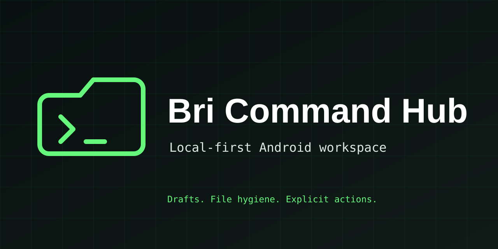

# Bri Command Hub

A local-first Android workspace for focused content work and file hygiene.



## What it does

- Creates private content and WhatsApp-caption drafts, never sends them
- Generates a first-build milestone card locally for review
- Lists generated workspace files
- Moves one named regular file to quarantine and restores it later
- Offers an opt-in, read-only root-status diagnostic

## Safety by design

Bri Command Hub uses fixed, visible actions instead of accepting arbitrary shell commands. Ordinary work runs as the normal Termux user. It does not read WhatsApp chats, send messages, publish Status updates, hide root, weaken Android security, install apps, or change phone settings.

A WhatsApp Status handoff always ends in WhatsApp, where you review the media, choose the audience and tap the final Send control yourself.

## Install in Termux

```sh
git clone https://github.com/gunabryun/bri-command-hub-public.git
cd bri-command-hub-public
bash install.sh
~/.local/bin/bri-hub init
```

## Try it

```sh
~/.local/bin/bri-hub status
~/.local/bin/bri-hub new-draft localsend-guide
~/.local/bin/bri-hub prepare-whatsapp milestone
~/.local/bin/bri-hub create-first-build-card
~/.local/bin/bri-hub list-generated
```

## Roadmap

See [ROADMAP.md](ROADMAP.md) for the next practical steps and the project boundaries.

## Project status

First public build. Built by Brian Guna as part of NexVanta’s practical Android and Linux work, with a focus on local-first tools and clear human approval.

## Notes

This is an early, deliberately small project. Review the scripts before running them and use it only on files in its own workspace.
